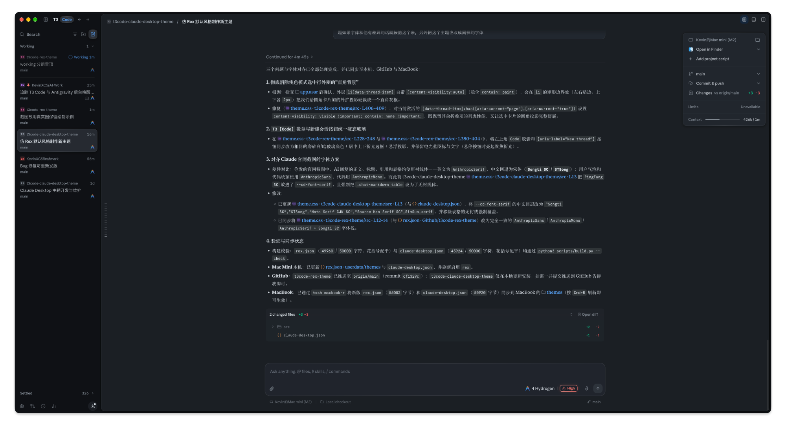
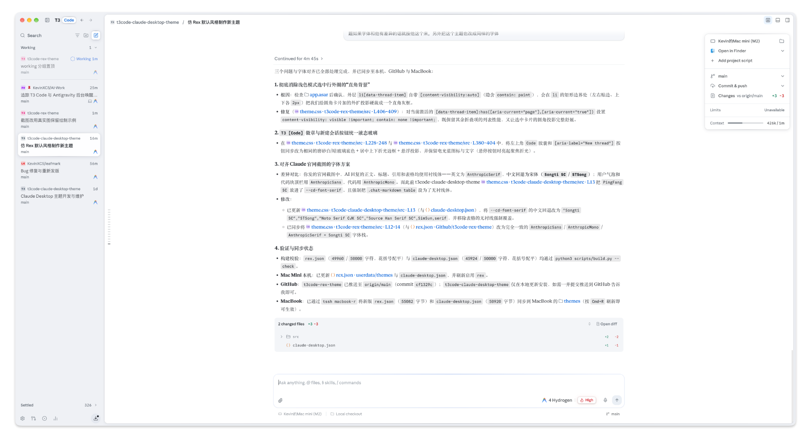
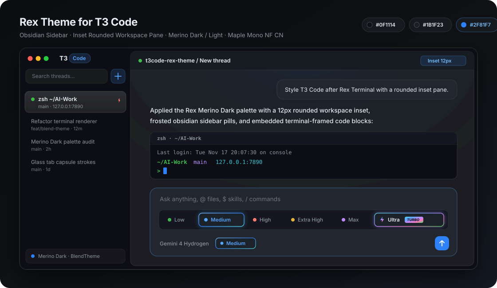

<div align="center">

# Rex Theme for T3 Code

**A crisp, terminal-native [Rex](https://rex.superlogical.com)-inspired theme for [T3 Code](https://t3.codes) — featuring a two-tier obsidian shell, an inset `12px` rounded workspace pane with centered Liquid Glass edge refraction, `Merino Dark` & `Merino Light` palettes, Liquid Glass active rows & controls, `AnthropicSerif` + `Songti SC` editorial prose, and a 6-tier comet-laser effort selector.**

[English](README.md) · [简体中文](README_zh.md)

<p>
  
  
  
  
</p>

| Dark Mode (`Merino Dark`) | Light Mode (`Merino Light`) |
| :---: | :---: |
|  |  |

</div>

---

## Quick Install

### macOS / Linux (One-Liner)

```bash
# Install into ~/.t3/userdata/themes/rex.json
curl -fsSL https://raw.githubusercontent.com/KevinXC5/t3code-rex-theme/main/install.sh | bash

# Or install and automatically activate as defaultTheme
curl -fsSL https://raw.githubusercontent.com/KevinXC5/t3code-rex-theme/main/install.sh | bash -s -- --activate
```

### Windows (PowerShell)

```powershell
# Install into %USERPROFILE%\.t3\userdata\themes\rex.json
irm https://raw.githubusercontent.com/KevinXC5/t3code-rex-theme/main/install.ps1 | iex

# Or install and activate automatically
& ([scriptblock]::Create((irm https://raw.githubusercontent.com/KevinXC5/t3code-rex-theme/main/install.ps1))) -Activate
```

### Manual Import (T3 Code UI)

1. Download [`rex.json`](rex.json) (or copy it to `~/.t3/userdata/themes/rex.json`).
2. Open **T3 Code → Settings → Appearance**.
3. Import or select **Rex** (supports **Dark**, **Light**, and **System** appearance modes).

---

## Design Details

### 1. Two-Tier Obsidian Shell & Inset Rounded Workspace Pane

Faithfully translates Rex Terminal's `BlendTheme` + `Merino Dark` / `Merino Light` depth hierarchy into T3 Code:

| Role | Dark Mode (`Merino Dark`) | Light Mode (`Merino Light`) | Purpose |
| :--- | :---: | :---: | :--- |
| **Window Shell & Sidebar** | `#0F1114` | `#EEF1F5` | Outer obsidian-slate frame & thread navigation |
| **Right Workspace Pane** | `#1B1F23` | `#FFFFFF` | Inset `12px` rounded card with centered top/bottom Liquid Glass refraction |
| **Terminal & Code Blocks** | `#0D1117` | `#F6F8FA` | Embedded terminal-grade code blocks & integrated terminal drawer |
| **Frosted Glass Surfaces** | `rgba(38,44,53,0.72)` | `rgba(255,255,255,0.96)` | Active sidebar row, details card, composer & header pill |
| **Primary Accent** | `#2F81F7` | `#0969DA` | Rex cursor blue — send squircle, links, focus rings, trees & diffs |
| **Pin Indicator** | `#FF7B72` | `#CF222E` | Merino ANSI coral-red pin icon |

### 2. Centered Liquid Glass Refraction & Unified Controls

- **Inset `12px` Right Workspace Panel**: On desktop layouts, `main[data-slot="sidebar-inset"]` floats inside the unified `#0F1114` / `#EEF1F5` shell with `7px` outer gutters (`4px` beside the sidebar), `12px` rounded corners, and a `1px` masked Liquid Glass rim whose top and bottom highlights peak horizontally at the center and feather smoothly toward both sides.
- **Unified Liquid Glass Components**: The active sidebar thread row, top-right details card (`[data-thread-details-card]`), bottom composer, `T3 [Code]` pill, and `New thread` button all share the same flat frosted-glass surface and centered top/bottom refraction border — with `content-visibility: visible` on the active `[data-thread-item]` so drop shadows never clip into sharp rectangles.
- **Editorial Serif + Terminal Typography**: Matches Claude's official typography — `AnthropicSerif` / `Tiempos Text` + `Songti SC` (`15px`, `1.72` line-height) for assistant prose, headings, blockquotes, and tables; `AnthropicSans` + `PingFang SC` for UI controls, user bubbles, work logs, and code block headers; and `AnthropicMono` / `Maple Mono NF CN` / `JetBrains Mono` for code & terminals.

### 3. Unified Sapphire Accent & UI Polish

- **Unified Selection, Trees & Diffs**: Unifies text `::selection`, `@pierre/trees` active rows, `@pierre/diffs` modified markers/carets, citation chips, and switches into Rex's `#2F81F7` / `#58A6FF` spectrum (`#0969DA` in Light Mode).
- **Full-Color Sidebar Icons & Clean Inputs**: Preserves full-color provider/model badges in the sidebar and strips double inner outlines from sidebar search and dropdown combobox inputs.

### 4. Redesigned Model Picker & 6-Tier Comet-Laser Effort System


- **Horizontal Segmented Effort Bar**: Moves the reasoning selector to a wrapped bottom bar (`632px` popover, `360px` model list height) so 6-tier models (`Low` through `Ultra TURBO`) never clip horizontally.
- **Merino ANSI Spectrum + Comet Laser Rims**: Syncs `14px`/`15px` glyphs and dual-layer `background-clip: padding-box, border-box` flowing borders across the picker and bottom composer pill:
  - **Low / Minimal**: Merino Green (`#3FB950` / `#1A7F37`) + Feather glyph
  - **Medium**: Rex Sapphire (`#58A6FF` / `#0969DA`) + Dual-Sparkle glyph
  - **High**: Merino Coral Red (`#FF7B72` / `#CF222E`) + Flame glyph
  - **Extra High**: Merino Amber (`#E3B341` / `#9D5C00`) + Bolt glyph
  - **Max**: Merino Violet (`#BC8CFF` / `#8250DF`) + Crown glyph
  - **Extra / Ultra / Ultrathink**: Comet spectrum bolt + italic `TURBO` badge + full-spectrum flowing laser border

<details>
<summary>Vector Concept Diagram (assets/hero-preview.svg)</summary>



</details>

---

## Customize & Build from Source

The repository keeps a cleanly commented CSS source in [`src/theme.css`](src/theme.css) along with a zero-dependency build script [`scripts/build.py`](scripts/build.py) that safely minifies comments/whitespace and validates T3 Code's **50,000-character CSS budget**.

```bash
git clone https://github.com/KevinXC5/t3code-rex-theme.git
cd t3code-rex-theme

# Edit src/theme.css, then rebuild and validate rex.json
python3 scripts/build.py

# Verify rex.json matches src/theme.css
python3 scripts/build.py --check
```

---

## License

[MIT](LICENSE)
