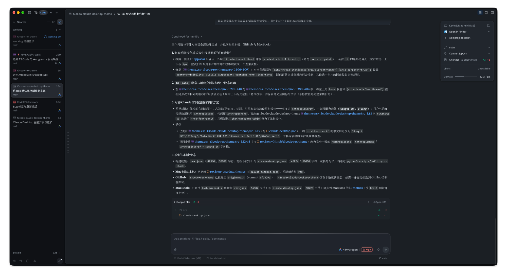
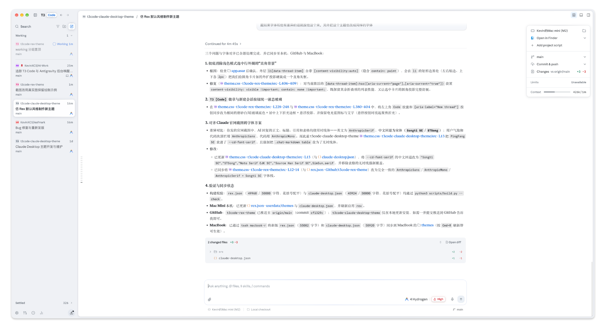
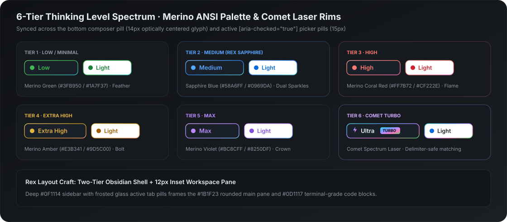
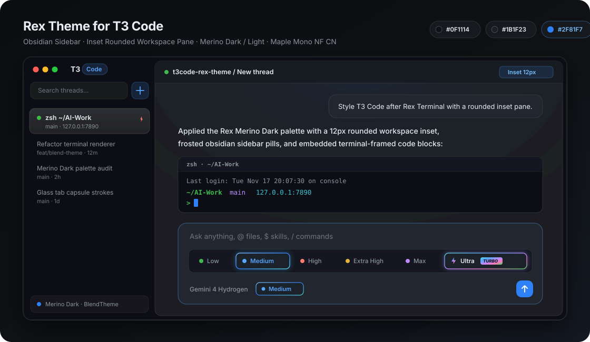

<div align="center">

# T3 Code · Rex 主题

**基于 [Rex](https://rex.superlogical.com) 终端默认视觉语言（`Merino Dark` / `Merino Light` + `BlendTheme`）打造的 [T3 Code](https://t3.codes) 主题——包含深曜石侧边栏外壳、带 `12px` 圆角与居中折光边框的右置主工作区面板、全链路液态玻璃控件、`AnthropicSerif + 宋体` 社论级排版，以及 6 档 Comet 流动镭射思考等级系统。**

[English](README.md) · [简体中文](README_zh.md)

<p>
  
  
  
  
</p>

| 暗色模式 (`Merino Dark`) | 浅色模式 (`Merino Light`) |
| :---: | :---: |
|  |  |

</div>

---

## 快速安装

### macOS / Linux（一键安装）

```bash
# 仅下载安装到 ~/.t3/userdata/themes/rex.json
curl -fsSL https://raw.githubusercontent.com/KevinXC5/t3code-rex-theme/main/install.sh | bash

# 安装并自动设为默认主题（写入 settings.json 的 defaultTheme）
curl -fsSL https://raw.githubusercontent.com/KevinXC5/t3code-rex-theme/main/install.sh | bash -s -- --activate
```

### Windows（PowerShell）

```powershell
# 安装到 %USERPROFILE%\.t3\userdata\themes\rex.json
irm https://raw.githubusercontent.com/KevinXC5/t3code-rex-theme/main/install.ps1 | iex

# 安装并自动设为默认主题
& ([scriptblock]::Create((irm https://raw.githubusercontent.com/KevinXC5/t3code-rex-theme/main/install.ps1))) -Activate
```

### 手动导入（T3 Code 界面）

1. 下载仓库中的 [`rex.json`](rex.json)（或手动放入 `~/.t3/userdata/themes/rex.json`）。
2. 打开 **T3 Code → Settings → Appearance**。
3. 导入或选择 **Rex**（完整支持 **Dark**、**Light** 与 **System** 外观切换）。

---

## 设计细节拆解

### 1. 双层曜石外壳与 Rex 风格色板

完整还原 Rex 默认 `Merino Dark` / `Merino Light` 配色与 `BlendTheme` 的双层景深：

| 色彩角色 | 暗色模式 (`Merino Dark`) | 浅色模式 (`Merino Light`) | 作用区域 |
| :--- | :---: | :---: | :--- |
| **窗口外壳与侧边栏** | `#0F1114` | `#EEF1F5` | 外层统一基底与会话导航 |
| **右置圆角工作区面板** | `#1B1F23` | `#FFFFFF` | 独立浮起的 `12px` 圆角主视口与居中折光边框 |
| **代码块与内置终端** | `#0D1117` | `#F6F8FA` | 嵌入式终端质感代码块与终端抽屉 |
| **液态玻璃控件表面** | `rgba(38,44,53,0.72)` | `rgba(255,255,255,0.96)` | 激活会话行、右上角详情卡、主对话框与徽章按钮 |
| **主题强调色** | `#2F81F7` | `#0969DA` | Rex 光标蓝——发送按钮、链接、聚焦框、文件树与 Diff |
| **置顶图钉** | `#FF7B72` | `#CF222E` | Merino ANSI 珊瑚红图钉标识 |

### 2. 居中液态玻璃折光与全链路字体对齐

- **右侧圆角面板与居中折光高光**：桌面端下，`main[data-slot="sidebar-inset"]` 以 `7px` 外留白（靠近侧边栏一侧为 `4px`）悬浮于 `#0F1114` / `#EEF1F5` 底板之上，配备 `12px` 圆角及上下边框**从左到中渐强、再向右侧减弱**的 `1px` 液态玻璃折光高光。
- **全组件统一液态玻璃质感**：侧边栏激活会话行、右上角详情卡片（`[data-thread-details-card]`）、底部主对话框、`T3 [Code]` 徽章与 `New thread` 新建按钮均采用统一的半透磨砂表面与居中折光边框，同时解除激活项 `[data-thread-item]` 的 `content-visibility` 裁切，确保柔和投影不出现直角残影。
- **对齐 Claude 官方混合字体栈**：AI 回复、标题、引用与表格采用 `AnthropicSerif` / `Tiempos Text` + `Songti SC` 宋体（`15px` 字号 + `1.72` 行高）；UI 控件、用户消息与代码块顶栏使用 `AnthropicSans` + `PingFang SC`；代码块与内置终端使用 `AnthropicMono` / `Maple Mono NF CN` / `JetBrains Mono`。

### 3. 全链路电光蓝统一与细节打磨

- **统一选区、文件树与 Diff 色彩**：将划词 `::selection`、`@pierre/trees` 选中高亮、`@pierre/diffs` 修改标记与光标、引用标签与开关控件统一为 Rex 电光蓝。
- **保留侧栏彩色图标并清理冗余描边**：保留侧边栏全彩供应商图标，移除侧边栏搜索框与项目下拉框内部多余的双层直角描边。

### 4. 模型选择弹窗与 6 档 Comet 流动镭射思考等级



- **底部横向分段式选择条**：将思考等级移动至模型弹窗底部并支持自动换行（`632px` 宽弹窗 + `360px` 列表高度），确保 6 档模型完整展示不被裁切。
- **Merino ANSI 色谱 + Comet 流动镭射边框**：弹窗内与底部输入栏触发器同步显示 `14px`/`15px` 图标与 `1px` 双层流光框：
  - **Low / Minimal**：Merino 翠绿（`#3FB950` / `#1A7F37`）+ 轻羽图标
  - **Medium**：Rex 电光蓝（`#58A6FF` / `#0969DA`）+ 双星火花图标
  - **High**：Merino 珊瑚红（`#FF7B72` / `#CF222E`）+ 火焰图标
  - **Extra High**：Merino 琥珀金（`#E3B341` / `#9D5C00`）+ 单闪电图标
  - **Max**：Merino 幻紫（`#BC8CFF` / `#8250DF`）+ 皇冠图标
  - **Extra / Ultra / Ultrathink**：Comet 全彩流光闪电 + 斜体 `TURBO` 徽章 + 全谱流动边框

<details>
<summary>矢量概念示意图（assets/hero-preview.svg）</summary>



</details>

---

## 二次修改与构建

仓库保留了带完整分段注释的可读源码 [`src/theme.css`](src/theme.css)，以及零依赖构建脚本 [`scripts/build.py`](scripts/build.py)（自动安全压缩注释与空白，并校验花括号配平及 T3 Code 的 **50,000 字符 CSS 上限**）：

```bash
git clone https://github.com/KevinXC5/t3code-rex-theme.git
cd t3code-rex-theme

# 修改 src/theme.css 后重新打包为 rex.json
python3 scripts/build.py

# 校验 rex.json 与 src/theme.css 是否保持同步
python3 scripts/build.py --check
```

---

## 开源协议

[MIT](LICENSE)
